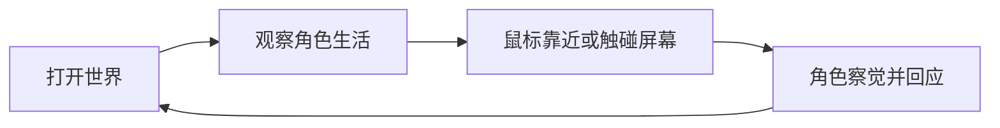

# 01 · 产品愿景

> **状态**：定稿
> **上游**：无（顶层文档）
> **下游**：[02-角色系统](02-角色系统.md)、[03-屏幕与交互](03-屏幕与交互.md)、[04-游戏外壳](04-游戏外壳.md)、[06-世界包协议](06-世界包协议.md)

## 1. 产品定位

tylpet 不再只被定义为一个带 3D 角色的桌面宠物，而是一个运行在电脑上的**异世界观察窗口**：玩家通过屏幕观察另一个空间中的角色，与她建立有限但持续的联系。桌宠只是其中一种角色形态，不是产品边界。

核心使用循环：

默认关系：

- 玩家是观察者，不直接操纵镜头；
- 世界在没有用户操作时仍然存在；
- 角色以轻度自主方式进行自己的日常活动；
- 玩家通过屏幕、鼠标和消息与世界建立联系；
- 角色从一开始就知道屏幕后面存在用户。

## 2. 第一阶段的显示形态

第一阶段是独立全屏游戏，不直接作为 Windows 桌面壁纸层实现。玩家画面被定义为异世界中一块悬浮虚拟屏幕的另一侧视野：

- 玩家通常看不到悬浮虚拟屏幕的正面；
- 角色可以看到、靠近、注视、触碰或敲击这块屏幕；
- 屏幕本身显示半透明空白内容，不实时捕获用户桌面，也不读取桌面像素；
- 鼠标和聊天消息被转换为角色能够理解的用户信号；
- 角色对屏幕的行为反过来证明异世界与玩家之间存在连接。

透明桌面叠加形态保留为第二阶段目标，技术结论见 [09-第二阶段预留](09-第二阶段预留.md)；两种形态共用同一套世界运行时，但第一阶段不把两种窗口形态混为一个实现目标。

## 3. 用户信号

第一阶段角色可感知三类用户信号：

| 信号 | 异世界表现 |
| --- | --- |
| 鼠标位置或靠近屏幕 | 屏幕上出现可被角色追踪的光点 |
| 鼠标点击屏幕 | 产生触点、波纹或敲击反馈，角色可被唤醒或打断 |
| 游戏内聊天面板消息 | 角色转向屏幕，并以动作、3D 悬浮文字和 TTS 回应 |

光点和触点首版对玩家与角色都可见。信号的具体交互规则见 [03-屏幕与交互](03-屏幕与交互.md)。

## 4. 两种世界模式

所有内容统一称为 **World Pack（世界包）**，由包内声明运行模式：

### editable-grid：可运行时布置的 Blender 无限网格世界

- 视觉上向远处无限延伸，实际活动区可以有限；
- 程序化生成网格、坐标轴、透明背景和活动区域；
- 角色可以在活动区内生活，并使用声明过的物件；
- 第一阶段的默认世界属于此模式，但首个世界不放物件（见第 7 节）。

### authored-scene：作者预制的完整场景世界

- 作者在 Blender 或其他外部工具中完成场景布局后导入；
- 运行时不能随意添加新物件，也不能自由改动场景布局；
- 角色可在作者定义的活动区、路径或交互点之间自主移动；
- 物件的位置和可用能力由作者预先声明；
- 适用于房间、观测站、庭院等完整创作型世界。

两种模式必须在用户界面和资产协议中明确区分能力边界，避免用户误以为所有场景都可以自由编辑。

## 5. 产品形态定位：官方本体优先，社区为附加

**这是产品的顶层定位，一切内容决策的前提。**

tylpet 是**有官方 IP 本体的角色陪伴产品**，不是「桌宠 / 场景创作引擎」。具体含义：

- **官方负责第一个角色与第一个世界**：首个人格原型为安静观察者，首个交付世界由官方做透（角色 + 场景 + 灯光 + 镜头 + 行为一体调过），玩家拿到的是「她 + 她的世界」这一完整体验，而不是一套待填充的空壳；
- **社区内容是附加项**：第三方世界包的定位是「**给她换个家**」——换的是环境、氛围、作息节奏，不是换掉她本人。角色人格、活动规则、核心交互协议始终由官方侧定义，作者可以在协议范围内做表达（见 [06-世界包协议](06-世界包协议.md)）；
- **第一阶段只做「可导入」**：外部工具制作 + 资产包导入 + 运行时有限调整，暂不开发完整内置世界编辑器，也不做在线工坊、分享与审核（见 [06-世界包协议](06-世界包协议.md) 第 7 节）。

**为什么不选「创意工坊平台优先」**：平台路线（VRChat / Roblox 式）上限最高，但冷启动极难——没有初始内容就没有玩家，没有玩家就没有创作者。更重要的是，第三方角色会直接冲击角色人格权威，与 [02-角色系统](02-角色系统.md) 已锁定的「人格滑杆属作者配置、角色有人权」直接冲突。IP 必须靠可控的初始体验养成，工坊是 IP 成立之后的扩展，不是取代。

World Pack 仍包含角色、场景、物件、镜头、灯光、行为六个槽位，协议细节见 [06-世界包协议](06-世界包协议.md)。

## 6. 角色活人感的首阶段原则

用户希望角色具备持续日常活动、环境感知、偶尔主动反应、记忆连续性和自主改变环境的能力。第一阶段优先保证前两项体验：

1. 角色在没有用户操作时仍有持续的日常活动；
2. 角色会偶尔主动发现用户、看向屏幕或做出简短回应。

行为生成采用“**作者预设活动骨架 + AI 小范围变体**”模式：不允许 AI 无约束地决定场景结构、任意生成物件行为或绕过权限执行动作。首阶段首要验证的是“她在生活”，而不是“她拥有完整自主意识”。完整模型见 [02-角色系统](02-角色系统.md)。

## 7. 世界、角色与身份关系

世界状态与角色身份分离保存：

- **角色档案**：角色名称、性格、关系、记忆和可迁移偏好；
- **世界存档**：当前世界、活动进度、物件状态、环境状态和事件记录；
- **当前组合**：正在使用的世界包 ID 与版本。

更换角色模型时，第一阶段默认将其视为新角色；用户可以明确选择继承旧角色的部分记忆。继承范围优先支持称呼、偏好、关系摘要和羁绊等级，不直接迁移完整聊天记录。

该身份模型仍属于后续需要继续细化的设计项，但不得把所有记忆简单绑定到 VRM 文件或某一个场景包中。

## 8. 首个世界验收样本

第一阶段使用“Blender 无限网格中的独立角色”作为平台验收世界：

- 程序化无限网格作为空间底座；
- 角色在有限活动区内轻度自主生活；
- 场景中存在统一的半透明悬浮虚拟屏幕锚点；
- 用户可通过光点和点击触碰屏幕；
- 第一阶段不放入物件，先验证角色生活与用户屏幕关系；
- 固定观察镜头为默认镜头，重要事件允许切换作者提供的预设镜头；
- 对话通过游戏内聊天面板输入，角色以动作、3D 文字和 TTS 回应。

首个人格原型为**安静观察者**（内向 / 好奇 / 慢热）：大部分时间自己发呆或漫步，偶尔看向屏幕。

### 8.1 网格是开发场景，默认房间是玩家场景（已决策）

无限网格**没有人情味，不适合作为玩家实际游玩的场景**；它的定位是**第一阶段开发与性能验收场景**，用于验证世界运行时、角色自主生活和屏幕交互协议，不承担首发体验。

面向玩家的首个正式场景是**官方制作的「默认房间」**（`authored-scene` 模式），顺延到第二阶段：

- 默认房间由官方做透，与安静观察者人格、作息、光照、镜头一体调校，是 IP 的第一张脸；
- 第二阶段交付时，用默认房间**整体替换**网格交付给玩家，网格退化为内部调试工具；
- 网格与房间同属「世界包」，切换走既有的整包切换路径，不需要新的运行时机制。

世界内时间与天气作为第二条生活线：时间系统在 [06-世界包协议](06-世界包协议.md) 第 8 节已定稿（**与玩家本地时钟对齐**），天气在第 9 节已定为四态核心状态机，第一阶段只实现逻辑（[08-实施路线](08-实施路线.md) Phase 1）。完整的天气表现随默认房间阶段落地。

## 9. 首次进入与持续恢复

第一次打开采用三段渐进式开场，总长约 30~60 秒。开场是**一次性固定脚本演出**，由固定时间轴 + 预设动画与镜头驱动，每次一致、完全可控，不依赖需求状态：

| 时间 | 内容 |
| --- | --- |
| 0~15 秒 | 角色在网格中发呆或漫步，世界安静运转，玩家先以观察者身份进入 |
| 15~35 秒 | 她看向悬浮虚拟屏幕，注意到光点（玩家指针），出现短暂的注视和好奇表现 |
| 35~60 秒 | 她走近屏幕、在屏幕前停留观察，然后回到自己的生活，控制权交还玩家 |

开场期间不响应玩家输入，也不提供跳过——因为它是首次启动的一次性事件，玩家没有可被打断的预期。开场结束后立即进入自主生活（Ambient）。

首次进入时角色同时使用**偏活力开局**：需求初始值经人格公式推导后，由作者 override 设为精力偏高、无聊偏低（具体数值见 [02-角色系统](02-角色系统.md) 第 4.6 节）。该 override 只在首次进入生效，作用是**保证开场结束后角色不会立刻倒向休息**，而不是驱动开场演出本身。

之后再次打开直接从上次状态恢复，不重复播放首次开场。保存内容包括最后活动、最后位置、当前关注目标和轻量需求状态；不模拟关闭期间的完整行为，不生成虚构的离线经历。

## 10. 第一阶段暂不承诺

- 实时显示用户真实桌面或当前窗口；
- 读取或重绘 Windows 桌面图标；
- 让角色直接操作真实桌面文件、图标或应用；
- 完整的用户自由镜头控制；
- authored-scene 世界的运行时自由摆放物件；
- AI 完全自主制定长期日程或改变世界结构。

## 11. 与现有系统的改造边界

3D 改造只替换渲染层、空间交互层和窗口层，保留全部业务能力：

| 现有模块 | 策略 |
| --- | --- |
| src/domain/chat、src/providers、src-tauri/src/chat.rs | 保留 AI Provider、流式对话、Mock、SSE 和取消机制 |
| src/domain/memory、src-tauri/src/memory.rs | 保留长期记忆、摘要、羁绊和恢复能力 |
| TauriTimerController、src-tauri/src/timer.rs | 保留可靠番茄钟，开启时驱动 Focus |
| src/domain/observations、src-tauri/src/plugins.rs | 保留观察事件和插件安全边界，可增加受限 scene.* 请求 |
| TTS、托盘、设置、退出路径 | 保留；形式改造为游戏外壳（见 04） |

新增内容：全屏游戏窗口、Three.js 场景、Viewport Grid、VRM 角色、生活调度器、屏幕交互、3D 浮空文字、世界包加载。
