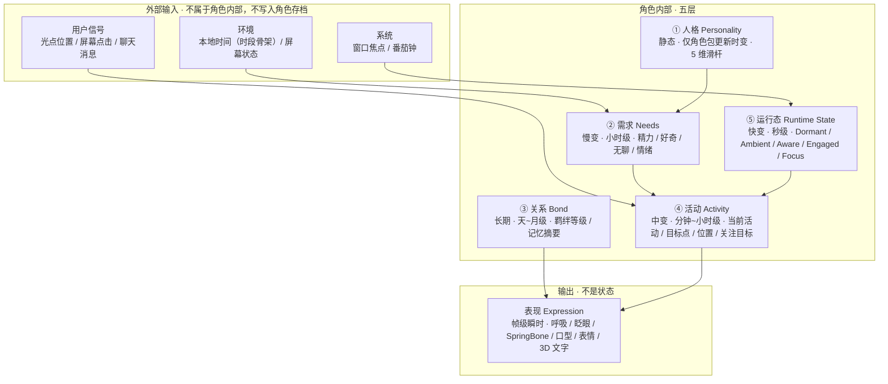
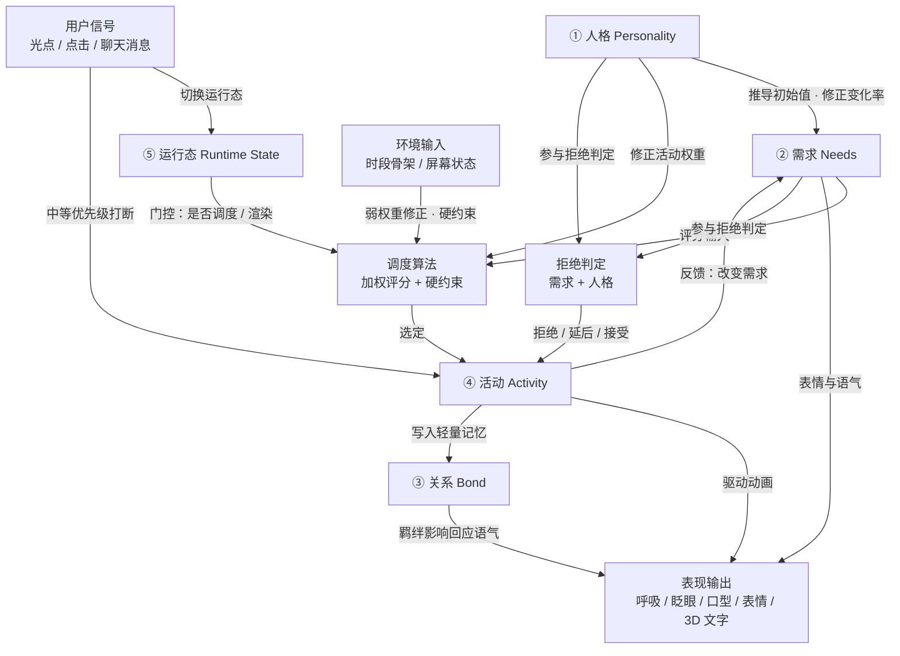

# 02 · 角色系统

> **状态**：定稿
> **上游**：[01-产品愿景](01-产品愿景.md)
> **下游**：[03-屏幕与交互](03-屏幕与交互.md)、[05-表现层](05-表现层.md)、[06-世界包协议](06-世界包协议.md)、[07-渲染与性能](07-渲染与性能.md)

本档定义角色的“活人感”如何产生：她做什么、为什么做、如何被打断、记得什么、拥有哪些不可侵犯的边界。

## 1. 首版活动集合

第一个 Blender 无限网格世界的首版活动集合固定为五项：

1. **站立待机**：呼吸、眨眼、重心和轻微视线变化；
2. **网格漫步**：在屏幕前的有限活动区内，向明确目标点行走并停留；
3. **休息发呆**：坐下、停留、看向远处或短暂放空；
4. **观察屏幕**：从远处注意屏幕、走近、在屏幕前观察光点；
5. **触碰屏幕后等待回应**：确认用户存在，短暂等待后恢复自己的生活。

活动采用**低频、长持续时间**，不靠高频随机动画堆砌存在感。角色大多数时间保持在玩家视野内，允许短暂离开当前焦点，但不允许长时间消失。默认时间分配以休息和漫步为主，偶尔观察屏幕；具体分布由人格、需求状态和世界时间共同影响。

**枚举封闭**（已决策）：这五项 ID 固定，**天气不引入新活动**——雨雪只通过活动乘子改变既有活动的倾向（见 [06-世界包协议](06-世界包协议.md) 第 9.2 节），不新增「躲雨」「赏雪」等类别。天气因此不需要新的动画资产。

**活人感来自「同一活动的不同表现」，不来自「活动种类」**（已决策）：「站着不动」永远播同一个循环片段就是机器人在待机；如果她有时抱臂、有时低头看手、有时伸手碰飘过的东西——活动 ID 仍是 `stand`，调度逻辑完全不变，但玩家立刻觉得这是个人。因此自然感的主引擎是**程序化加性微动层**（呼吸 / 重心 / 眨眼 / 视线惯性，常驻叠加，见 [07-渲染与性能](07-渲染与性能.md) 第 5.1 节），变体资产只是辅助，且 Phase 1 每活动只做 1 个片段。

这同时反过来加固了本节的枚举封闭：既然自然感不靠新活动撑，就没有理由为「表现力」去扩活动 ID。

**活动结果**：每次活动完成后至少产生一种轻量结果，让行为不是无意义循环：

- 漫步后保留新的空间位置；
- 观察屏幕后短时间保持对屏幕或光点的关注；
- 休息改变精力状态；
- 活动留下最近活动、最后位置或屏幕回应等轻量记忆事件。

## 2. 角色状态模型总览

本档涉及多个容易被统称为“状态”的概念。为避免混用，全文统一使用以下五个术语：

| 术语 | 英文标识 | 含义 | 谁改它 | 生命周期 |
| --- | --- | --- | --- | --- |
| 人格 | Personality | 角色的稳定性格，5 个 0~1 滑杆 | 角色作者（角色包） | 静态，仅角色包更新时变 |
| 需求 | Needs | 角色的内部驱动力，4 个 0~1 值 | 时间、活动、互动事件 | 慢变，小时级 |
| 关系 | Bond | 与用户的长期关系、羁绊等级与记忆摘要 | 长期互动累积、用户确认 | 长期，天~月级 |
| 活动 | Activity | 角色当前正在做的事（五活动之一） | 调度器 | 中变，分钟~小时级 |
| 运行态 | Runtime State | 引擎级运行门控（五态） | 窗口焦点、用户输入、番茄钟 | 快变，秒级 |

**用词约定**：描述角色心情时一律称“需求”，不再使用“状态”一词；“运行状态机五态”只指 Runtime State。表现层（呼吸、眨眼、口型、表情、3D 文字）是**输出**，不是角色状态。

### 2.1 分层结构



### 2.2 因果图



### 2.3 影响关系速查

| 影响源 | 影响目标 | 影响方式 |
| --- | --- | --- |
| ① 人格 | ② 需求 | 推导需求初始值；修正需求变化速率 |
| ① 人格 | 调度算法 | 修正各活动评分权重 |
| ① 人格 | 拒绝判定 | 依赖 / 外向越低，越容易拒绝或延后 |
| ② 需求 | 调度算法 | 软评分输入 + 硬约束触发 |
| ② 需求 | 表现 | 情绪影响表情与回应语气 |
| ② 需求 | 拒绝判定 | 精力过低、情绪低落时更容易拒绝 |
| 环境（时段） | 调度算法 | 弱权重修正（±20%） |
| 环境（屏幕） | 调度算法 | 提供活动条件；缺失时硬约束排除 |
| ④ 活动 | ② 需求 | 按 4.2 的变化速率反馈 |
| ④ 活动 | 表现 | 决定当前动画与动作 |
| ④ 活动 | ③ 关系 | 活动结果写入轻量记忆事件 |
| ⑤ 运行态 | 调度算法 | 门控：Dormant 不调度；Focus 降低主动行为 |
| 用户信号 | ⑤ 运行态 | 输入 → Aware；对话 → Engaged |
| 用户信号 | ④ 活动 | 中等优先级打断 |
| ③ 关系 | 表现 | 羁绊等级影响回应语气 |
| 用户偏好（节奏） | ② 需求 | 全局倍率 ×0.7 / ×1.0 / ×1.4 |

用户信号、时段、屏幕状态、番茄钟、窗口焦点都是**输入**，不属于角色内部状态，也不写入角色存档（时段由系统时间实时推导）。

## 3. 人格模型

首版角色拥有以下作者配置的人格维度，使用 0~1 连续滑杆表达：

| 维度 | ID | 影响 |
| --- | --- | --- |
| 外向 / 内向 | `extraversion` | 主动靠近屏幕、主动回应的频率 |
| 活跃 / 慢热 | `liveliness` | 走动、活动切换和探索倾向 |
| 好奇 / 安静 | `openness` | 观察新物件、触点和环境变化的倾向 |
| 依赖 / 独立 | `attachment` | 是否频繁寻找用户，还是更愿意自己生活 |
| 乐观 / 敏感 | `optimism` | 对事件、用户反馈和环境变化的情绪反应 |

**人格归属**：初始值由角色作者配置。普通用户不能通过设置随意重写角色人格——这部分属于角色自身的主体性。用户首版只可以设置系统层面的活动节奏偏好（安静 / 标准 / 活跃），不能直接改变角色是谁。

首个默认角色为**安静观察者**原型：内向偏高、好奇中等、慢热，依赖偏低。

## 4. 需求模型

角色内部驱动力使用需求模型推动活动选择。四个需求均为 **0~1 连续值**，初始值由人格滑杆线性推导（推导公式见 4.6 节），统一单位便于加权计算。

| 需求 | ID | 作用 | 初始值推导依据 |
| --- | --- | --- | --- |
| 精力 | `energy` | 影响活动强度和休息倾向 | 活跃 / 慢热（`liveliness`）：越活跃初始精力越高 |
| 好奇 | `curiosity` | 推动观察屏幕和发现变化 | 好奇 / 安静（`openness`）：越好奇初始值越高 |
| 无聊 | `boredom` | 推动离开当前活动并寻找变化 | 活跃 / 慢热 + 好奇 / 安静共同推导：越活跃好奇，无聊上升越快，初始值越低 |
| 情绪 | `mood` | 影响行为选择、表情和回应语气 | 乐观 / 敏感（`optimism`）：越乐观初始情绪越高 |

**情绪为单一标量 0~1**：0 = 低落 / 委屈，0.5 = 平静，1 = 开心 / 兴奋。第一版不引入效价 + 唤醒度二维模型，也不用独立情绪标签；表情与语气的细分由表现层根据标量值 + 当前活动共同决定。

### 4.1 基础变化速率（慢节奏）

无活动时的自然变化率（每小时）：

| 需求 | 自然变化 | 说明 |
| --- | --- | --- |
| 精力 | -0.05 / h | 缓慢消耗，清醒状态本身需要维持 |
| 好奇 | -0.03 / h | 没有新刺激时好奇心缓慢消退 |
| 无聊 | +0.08 / h | 无所事事时无聊感缓慢积累 |
| 情绪 | ±0.02 / h 以内 | 极慢漂移，不主动大起大落 |

用户的"活动节奏偏好"（安静/标准/活跃）作为全局倍率作用于变化速率：安静模式 ×0.7，标准 ×1.0，活跃 ×1.4。只影响节奏快慢，不改变需求间的相对关系。

### 4.2 活动对需求的影响

五活动对精力的影响方向与速率（每小时近似值）：

| 活动 | 精力 | 好奇 | 无聊 | 情绪 |
| --- | --- | --- | --- | --- |
| 站立待机 | ±0.005（几乎不变） | -0.02 | +0.08 | 0 |
| 网格漫步 | -0.08 | +0.04 | -0.10 | +0.02 |
| 休息发呆 | +0.10 | -0.04 | +0.05 | +0.03 |
| 观察屏幕 | -0.05 | -0.06（观察后好奇被满足） | -0.08 | +0.03 |
| 触碰屏幕等待 | -0.03 | +0.02 | -0.05 | ±0.05（取决于回应） |

原则：走动和观察消耗精力，休息恢复精力，待机几乎不消耗；新奇刺激降低无聊、满足好奇；互动结果影响情绪。

### 4.3 调度算法：加权评分 + 硬约束

```text
总分(活动) = [ Σ(需求值 × 需求权重) + 人格修正 + 随机噪声 ] × 天气乘子(当前天气, 活动)
```

活动得分为总分最高且通过硬约束者胜出。乘子在最后施加，保证人格运算与天气影响在数学上隔离、可分别单测。

**参与评分的需求与符号语义**：

- 参与权重的只有 `energy`、`curiosity`、`boredom` 三者，`mood` 不参与活动选择（只影响表现与拒绝判定）；
- **权重为正 = 该需求越高越倾向此活动**。例如 `walk` 的 `energy` 权重为正（精力充沛更愿意走动），`rest` 的 `energy` 权重为负（精力越低越想休息）；
- 每个活动的权重系数写在角色包 JSON 中，不硬编码。

**天气乘子**（见 [06-世界包协议](06-世界包协议.md) 第 9.2 节）：按「当前天气 × 活动」独立取值，乘在总分之外。天气只表达「此刻适合不适合做这件事」，**不修改权重本身**——权重始终代表她的人格倾向，与天气正交。

**硬约束**（不满足直接排除，刻意保持精简）：

| 约束 | 规则 |
| --- | --- |
| 精力过低 | `energy < 0.2`：只能选择休息或待机 |
| 精力过盛 | `energy > 0.8`：排除休息 |
| 不可打断 | 正在执行不可打断活动时不重新调度 |
| 缺少条件 | 活动所需锚点 / 资源不存在（如观察屏幕需要虚拟屏幕锚点） |

精力在 0.2~0.8 区间内**只通过软评分产生倾向**，不做硬性限制；其余需求完全交给软评分自然调节，避免硬约束过多导致行为机械。

**软评分倾向**：

- 无聊越高 → 越倾向漫步、观察屏幕等变化性活动；
- 精力越高 → 越倾向漫步、观察屏幕；精力越低 → 越倾向休息、待机；
- 好奇越高 → 越倾向观察屏幕、触碰屏幕。

调度间隔与当前活动时长绑定：活动自然结束后触发重选，不做逐帧轮询。

### 4.4 日程骨架

采用真实本地时间的时间段骨架（白天 / 傍晚 / 夜间）作为全局权重修正，具体活动仍由需求和人格主导。时间段定义由世界包行为配置声明，默认世界使用：

| 时段 | 时间范围 | 权重修正倾向 |
| --- | --- | --- |
| 白天 | 08:00–18:00 | 精力充沛，漫步与观察屏幕权重略高 |
| 傍晚 | 18:00–22:00 | 情绪较好，观察屏幕与触碰权重略高 |
| 夜间 | 22:00–08:00 | 精力偏低，休息和待机权重显著提高 |

日程骨架是弱修正（权重浮动 ±20% 以内），不推翻需求驱动的主逻辑。

### 4.5 活动时长与结束条件

**活动时长完全由需求状态计算**，不使用固定时长或随机概率。每个活动声明一个或多个**目标需求阈值**，活动进行中持续结算需求变化，达到目标即结束。

| 活动 | 目标条件 | 时长特征 |
| --- | --- | --- |
| 站立待机 | 无聊 ≥ 0.7 **或** 精力 ≥ 0.8 时结束 | 短，过渡性活动 |
| 网格漫步 | 无聊 ≤ 0.3 结束 | 中等，取决于起始无聊值 |
| 休息发呆 | 精力 ≥ 0.7 结束 | 取决于起始精力缺口 |
| 观察屏幕 | 好奇 ≤ 0.4 结束 | 中等 |
| 触碰屏幕等待 | 好奇 ≤ 0.4、用户回应，或等待超时（45 秒）结束 | 短，受用户行为影响 |

同一活动内多个目标条件为 **OR** 关系；具体数值见 [06-世界包协议](06-世界包协议.md) 第 6.3 节的角色包默认值。

**预计时长计算**：活动开始时，根据当前需求值与目标阈值的差值 ÷ 该活动对该需求的变化速率，得到预计时长。用于调度器预判和 UI 展示，不强制锁定实际时长。

**兜底保护**：
- 单个活动设最短时长（约 30 秒），避免刚进入就因需求已达阈值而立刻结束造成抖动；
- 单个活动设最长时长（约 30 分钟），避免需求速率过低导致活动无限持续；
- 需求达到目标但仍在最长时长内，正常结束；超过最长时长仍未达标，强制结束并重新调度。

### 4.6 初始值推导公式

需求初始值由人格线性推导，公式形式统一为：

```text
initial = clamp(base + gain × 人格维度, 0, 1)
```

`base` 与 `gain` 写在角色包 JSON 中，不硬编码；`boredom` 由两个维度线性叠加：

```text
boredom.initial = clamp(base + gainA × liveliness + gainB × openness, 0, 1)
```

**作者覆盖**：角色包提供 `initialOverride` 字段，作者可直接指定某个需求的绝对初始值，优先于公式结果。用于表达人格无法推导的特殊开局（如“精力充沛但情绪低落”）。

**开局偏活力约定**：首次进入时，安静观察者使用 override 把开局设为偏活力状态（`energy` ≈ 0.75、`boredom` ≈ 0.25）。首次开场本身是固定脚本演出（见 [01-产品愿景](01-产品愿景.md) 第 9 节），不依赖需求状态；该 override 的作用是**保证开场结束后角色不会立刻倒向休息**，而是自然进入漫步或观察屏幕。override 只在**首次进入**生效；之后启动从存档恢复，不重复应用。

### 4.7 贴边行为（已决策）

需求值达到 0 或 1 后只做 `clamp`，**不引入额外机制**——不加贴边衰减力，也不做饱和软压缩。

理由：

- 自然速率会把值拉回中间（`energy` −0.05/h、`boredom` +0.08/h、`curiosity` −0.03/h），贴边只是暂时状态；
- 硬约束已排除极端活动（`energy < 0.2` 只能休息或待机、`> 0.8` 排除休息），不会出现单一活动被长期锁死；
- 活动评分中的随机噪声项可打破平局，避免重复感；
- 因此贴边既不会卡死行为，也不会造成可感知的机械重复，无需额外调参维度。

本决策为明确结论，后续不再重复讨论；若实测出现长期贴边导致行为单调，再回头评估。

## 5. 行为归属与配置职责

- **角色包**定义基础活动及其目标需求阈值、人格初始值、打断规则；
- **世界**提供活动区、虚拟屏幕锚点、目标点和移动限制；
- **用户**首版只能设置活动节奏偏好，不能改写人格或活动参数。

角色基础活动（观察屏幕、漫步、休息发呆）属于角色包，不要求每个世界作者重新编写；活动能力跨世界保持不变，由世界提供适配条件，缺少条件时使用通用兜底（站立、休息、看向远处）。

**参数存放位置**：活动权重、目标需求阈值、需求变化速率、硬约束阈值等**全部写在角色包的声明式 JSON 中**；调度器代码只实现通用算法（评分、硬约束、时长结算），不硬编码任何角色专属数值。这样换角色或调风格只需改配置，不改代码。

**角色包与世界的边界**：角色包提供**世界无关的默认值**，世界包的“行为”槽位**只声明差异**——覆盖某活动的权重、禁用本世界不支持的活动、调整时段骨架等；未声明的项一律沿用角色包默认值。协议细节见 [06-世界包协议](06-世界包协议.md) 第 6 节。

**动作资产与小动作习惯归角色包**（已决策）：每个活动的循环片段（含未来变体）与她的特色小动作习惯，都写入角色包，与世界包正交——她的习惯属于她本人，不随更换世界而改变，与人格同源。世界包只负责提供锚点、场景适配条件与表现响应。细节见 [07-渲染与性能](07-渲染与性能.md) 第 5.2 节。

**调度异常处理**：保留角色当前意愿和诊断信息，但将行为降级到安全活动，避免角色卡死。

## 6. 打断与恢复规则

- 角色因为点击或聊天消息中断日常活动后，**优先恢复被打断活动**；若需求或环境已变化，则重新选择下一项；
- 鼠标点击屏幕属于中等优先级：可提前结束漫步或待机，但不强制打断不可打断活动；
- 分级打断总原则：靠近只引起注意，点击和明确消息才产生更高优先级回应。

## 7. 移动与资产

- 角色采用**真实行走动画 + 明确目标点**，不做自由导航；
- 目标点由场景和屏幕提供固定锚点（活动区停留点 + 屏幕前点），角色根据需求与性格选择其一；
- 优先使用现成 VRMA / Mixamo 动作；缺少完整行走动画时降级为短距离移动和过渡动画；
- 每个动作单独验证骨骼映射、T-pose、Hip 高度和插件版本兼容性。

## 8. 主体性边界

角色不是无条件执行器。她可以根据自身状态、人格和当前活动拒绝或延后用户请求。拒绝优先通过行为表达（停顿、摇头、回避、继续活动或暂不靠近）；必要时再用简短 3D 文字和 TTS 说明。

**拒绝 / 延后判定**：由**需求状态 + 人格**共同决定，使用线性公式：

```text
refuseChance = clamp(base − k1 × energy − k2 × mood − k3 × attachment, 0, 1)
```

- 系数 `base` / `k1` / `k2` / `k3` 写在角色包 JSON 中，不硬编码；
- 精力越低、情绪越低落、依赖值越低，拒绝概率越高；
- 判定为拒绝时，再抽一个延迟时长（数十秒到数分钟），表现为“暂不靠近、稍后再来”而非永久拒绝；
- 判定只影响“是否 / 何时回应”，不改变角色人格本身，也不修改需求值。

### 8.1 休息与唤醒（已决策）

休息是合法活动，**不被禁用**；玩家撞见她在睡觉也是可以接受的日常，但必须能叫醒她。

**唤醒入口（两个，均已锁定）**：

| 入口 | 行为 |
| --- | --- |
| 点击悬浮虚拟屏幕 | 算作打扰她，进入唤醒流程 |
| 发送聊天消息 | 同样算作打扰她，进入唤醒流程 |

两个入口等价处理，都走统一的 refusal 判定，不存在「打字不算打扰」的区分。

**唤醒流程**：

1. 若她当前不在休息，入口走常规请求流程（[03-屏幕与交互](03-屏幕与交互.md)）；
2. 若她正在休息，先跑一次 `refuseChance` 判定：
   - **判定成功**：结束当前活动，进入`站立待机`，随后按常规流程响应玩家；
   - **判定失败**：她不醒，给一次轻量反馈（简短 3D 文字或翻身动作），本次请求作废；
3. 拒绝反馈**不设冷却**：玩家可立即再次尝试，每次都重新独立判定。

**判定参数**：唤醒沿用通用的 `refuseChance` 公式与角色包系数，不单独设一套。逻辑上精力越低（越困）、情绪越低落、依赖值越低，她越不肯醒；精力在 0.5 以上时几乎必定答应。

**与自然醒的关系**：休息的完成条件是 `energy >= 0.7`，达到后自然转入`站立待机`——与唤醒成功完全同路。玩家唤醒只是把这个时刻提前。

第一阶段必须遵守：

- 用户不能直接重写角色人格；
- 角色可以拒绝或延后请求；
- 系统不能强制角色被反复打扰，主动行为需要受需求阈值控制；
- 关系与记忆不能被无提示抹除；
- 更换世界或外观不能默认抹掉角色身份和经历。

## 9. 记忆范围

进入长期记忆的内容：

- 用户的称呼与沟通偏好（简洁/详细、语言偏好）；
- 重要事件摘要（用户明确保存或确认后的约定、事实、纪念日）；
- 角色自己的活动记忆（最近活动、最后位置、当前关注目标，属于世界存档）。

明确不做：

- 完整聊天记录持久化；
- 未经确认的自动事实提取；
- 离线期间的虚构经历（离线只做轻量状态结算，见 [04-游戏外壳](04-游戏外壳.md)）。

## 10. 基础生命感细节

- 呼吸：约 3.5 秒周期，胸腔和肩部微幅起伏；
- 眨眼：3~5 秒随机触发，偶发双眨眼；
- SpringBone：只保留马尾、发带、裙摆等关键链条，优先控制在 20 根以内；
- 所有定时器、rAF 和监听必须可清理。
