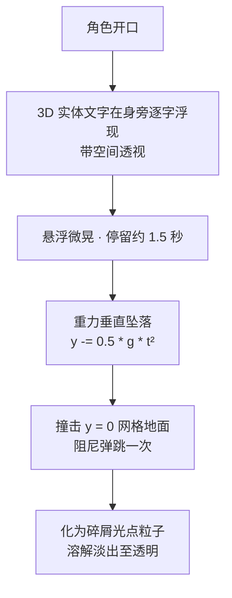

# 05 · 表现层

> **状态**：定稿
> **上游**：[01-产品愿景](01-产品愿景.md)、[03-屏幕与交互](03-屏幕与交互.md)
> **下游**：[08-实施路线](08-实施路线.md)

本档定义“看到和听到”的部分：3D 空间文字、口型、音频。

## 1. 3D 浮空文字与重力坠落

彻底弃用扁平 2D 气泡，采用纯 3D 空间实体文字（《米塔》同款语言）：

文字掉落在网格红绿轴上的瞬间，把“脚下是真实 3D 物理地面”的空间感强化数倍。

技术要求：

- 首选 SDF 字体或轻量文本几何，避免每个汉字创建过重几何；
- 字体、字号、字距和最大行宽必须配置化；
- 长回复不能全部塞进一个空间文字对象，应截取摘要或分段；
- 多条文字同时存在时设置上限、队列和回收机制；
- 文字特效只在 Engaged 状态或明确系统事件中启用。

### 1.1 分段规则

回复内容**完整呈现，不做摘要**（对话语义不可丢），按以下规则切分：

1. 优先在 `。！？；` 处切分；
2. 仍超过单段上限时，再在 `，` 处切分；
3. 仍超过时按字数硬切，不出现超长单段。

| 参数 | 取值 |
| --- | --- |
| 单段字数上限 | 24 字 |
| 同屏段落上限 | 3 段 |
| 超出上限 | 进入队列，按顺序坠落 |

前一段落地并溶解完成后**释放槽位**，队列中的下一段才入场。所有数值配置化，不硬编码。

### 1.2 字体方案

| 项 | 方案 |
| --- | --- |
| 字体 | 思源黑体（Source Han Sans / Noto Sans SC） |
| 许可证 | SIL OFL，允许商用与随包嵌入 |
| 字形集 | 子集化为 GB2312 一级汉字 + 常用标点，约 3800 字形 |
| 渲染 | 预生成 MSDF 图集，运行时按字形索引取样 |

生僻字与 GB2312 一级字以外的字符回退到系统字体；回退命中时记录日志，用于评估是否需要扩表。

## 2. 口型同步

- 第一版用 TTS 输出响度驱动 `aa` 等 blendshape 近似开口度（Windows SAPI 无音素时间戳）；
- 后续换带音素边界的 TTS 再升级。

## 3. 音频三层

| 层 | 内容 | 规则 |
| --- | --- | --- |
| 背景音乐 | lofi 音乐 | 来源为免版权库（CC0 / CC-BY 或已购授权）；逐曲记录曲名、作者、来源、许可证，维护授权清单 |
| 环境音 | 风声、网格微光嗡鸣、远处空间感 | 音量低于音乐 |
| 角色 TTS | 现有 Windows 本机 TTS，可中断朗读 | 保留现有实现 |

音乐、环境、TTS 在设置中分别控制音量与开关。世界包未来可自带音频槽位；第一阶段默认世界使用平台自带音乐。

## 4. 与画质分级的联动

文字粒子特效属于画质三档的控制项之一（低：关 / 中：简化 / 高：完整），完整定义见 [07-渲染与性能](07-渲染与性能.md)。
