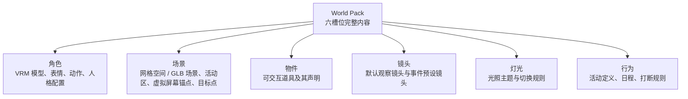

# 06 · 世界包协议

> **状态**：定稿（第一阶段范围）
> **上游**：[01-产品愿景](01-产品愿景.md)、[02-角色系统](02-角色系统.md)
> **下游**：[08-实施路线](08-实施路线.md)

本档定义创意工坊的资产格式：世界包如何组成、存放、校验。

## 1. 组合模型：完整世界包

一个世界包包含六个槽位的完整内容，作者交付一套完整体验，用户安装后得到“一个世界”：



**槽位化结构在协议中显式声明，但第一阶段只支持整体切换世界包，不支持槽位级替换。** 世界模式由包内声明：`worldMode: "editable-grid" | "authored-scene"`。

## 2. 目录结构

```text
worlds/
  <包ID>/
    <版本>/
      manifest.json
      preview.png
      characters/
        observer.vrm                 ← 角色模型
        observer.character.json      ← 角色配置：人格 / 需求 / 五活动默认值 / 拒绝系数
      scenes/
        grid.json                    ← 场景几何 + 锚点声明
      cameras/
        default.json                 ← 镜头槽位：默认镜头与事件预设镜头
      lighting/
        default.json                 ← 灯光槽位：环境光 + 三点光列表
      behaviors/
        default.json                 ← 行为槽位：相对角色包的差异声明
      props/                         ← 第一阶段为空
      animations/
      audio/
      fonts/
```

**角色槽位 = 模型 + 配置两部分**，采用同目录同名旁挂约定：`<name>.vrm` 配 `<name>.character.json`。世界包可携带多个角色，但第一阶段 manifest 只指向其中一个。

数据库记录当前激活的世界包；支持多版本共存与干净卸载。

## 3. manifest 最小字段

```json
{
  "id": "example.first-world",
  "version": "1.0.0",
  "title": "第一个世界",
  "author": "作者名",
  "engine": { "min": "0.1.0", "max": "0.x" },
  "worldMode": "editable-grid",
  "assets": {
    "character": {
      "model": "characters/observer.vrm",
      "config": "characters/observer.character.json"
    },
    "scene": "scenes/grid.json",
    "camera": "cameras/default.json",
    "lighting": "lighting/default.json",
    "behavior": "behaviors/default.json",
    "props": []
  }
}
```

| 字段 | 必填 | 说明 |
| --- | --- | --- |
| `assets.character.model` | 是 | 角色 VRM 模型 |
| `assets.character.config` | 是 | 角色配置 JSON |
| `assets.scene` | 是 | 场景几何与锚点声明 |
| `assets.camera` | 是 | 镜头槽位 |
| `assets.lighting` | 是 | 灯光槽位 |
| `assets.behavior` | 是 | 行为槽位（相对角色包的差异声明） |
| `assets.props` | 否 | 物件槽位，第一阶段固定为空数组 |

**manifest 是六个槽位路径的唯一索引**，不设隐式入口文件。任一必填路径缺失或指向不存在的文件时导入失败。

## 4. 场景、镜头与灯光声明

### 4.1 场景与锚点

场景槽位由 `assets.scene` 指向的 JSON 描述，包含场景几何与**锚点声明**两部分。锚点由场景声明，活动通过 `targetAnchor` 引用其**类型**。

```json
{
  "worldMode": "editable-grid",
  "grid": { "size": 1.0, "extent": 40, "color": "#2a2f3a" },
  "anchors": [
    { "id": "walk_zone_center", "type": "activity_zone", "position": [0, 0, 0],   "radius": 12.0 },
    { "id": "rest_spot_rock",   "type": "rest_spot",     "position": [6, 0, -4],  "radius": 1.2, "facing": [0, 0, 1] },
    { "id": "screen_front",     "type": "screen_front",  "position": [0, 0, 3],   "radius": 2.0, "facing": [0, 0, -1] }
  ]
}
```

| 字段 | 类型 | 必填 | 含义 |
| --- | --- | --- | --- |
| `id` | string | 是 | 包内唯一；世界包行为差异需固定到具体锚点时引用此值 |
| `type` | string | 是 | 锚点类型，活动通过 `targetAnchor` 引用此值 |
| `position` | `[x, y, z]` | 是 | 相对世界原点的坐标（米） |
| `radius` | number | 否 | 到达判定半径（米），默认 `1.0` |
| `facing` | `[x, y, z]` | 否 | 到达后角色朝向向量；缺省时朝向世界原点 |

**锚点类型为固定枚举**，与五活动一一对应，世界包不可新增：

| 类型 | 用途 | 必需性 |
| --- | --- | --- |
| `activity_zone` | 网格漫步的可巡游区域 | `walk` 启用时必需 |
| `rest_spot` | 休息点 | `rest` 启用时必需 |
| `screen_front` | 悬浮虚拟屏幕前的站位 | `observe_screen` / `touch_screen` 启用时必需 |
| `none` | 无需移动，原地执行 | 不查找锚点 |
| `shelter` | 有遮挡的位置（屋檐下、树冠下、遮蔽物后） | **室外场景雨天时**，`walk` / `stand` / `rest` 的可用目标点限定在此类区域内 |

`activity_zone` / `rest_spot` / `screen_front` / `none` 与五活动一一对应，`shelter` 是**选址约束用的补充类型**，不对应新活动（见第 9.2 节）。

规则：

- 活动按**类型**查找锚点；同类型存在多个实例时**随机挑选一个**，世界包差异声明可用 `targetAnchorId` 固定为某个具体锚点；
- 启用中的活动缺少必需锚点时，**只禁用该活动并给出警告**，不阻止整个包导入；
- 锚点坐标是世界本地坐标，不含玩家视角偏移，也不随屏幕窗口位置变化；
- **纯室内场景不声明 `shelter`**（她没有躲雨的需求，见第 9.2 节）；声明了 `shelter` 但当前天气非雨时，该约束不生效。

**职责边界**：世界包只声明虚拟屏幕的位置、朝向、尺寸与可接近范围（`screen_front` 锚点）；**鼠标光点与点击触点是核心固定的交互表现，不由世界包声明、不可被世界包覆盖**（见 [03-屏幕与交互](03-屏幕与交互.md) 第 2 节）。

### 4.2 镜头槽位

由 `assets.camera` 指向的 JSON 声明默认观察镜头与事件预设镜头。坐标为**世界绝对坐标**。

```json
{
  "default": "observe_wide",
  "cameras": [
    { "id": "observe_wide", "position": [0, 3.2, 9.0], "target": [0, 1.1, 0], "fov": 32, "damping": 0.15 },
    { "id": "screen_close", "position": [0, 1.8, 5.2], "target": [0, 1.2, 3], "fov": 28, "damping": 0.10 }
  ],
  "events": {
    "opening.phase2": { "camera": "screen_close", "holdSec": 20, "returnMode": "ease" },
    "screen.touch":   { "camera": "screen_close", "holdSec": 8,  "returnMode": "ease" }
  }
}
```

| 字段 | 类型 | 必填 | 含义 |
| --- | --- | --- | --- |
| `default` | string | 是 | 默认观察镜头的 `id`，必须能在 `cameras` 中找到 |
| `cameras[].id` | string | 是 | 包内唯一 |
| `cameras[].position` | `[x, y, z]` | 是 | 机位世界绝对坐标（米） |
| `cameras[].target` | `[x, y, z]` | 是 | 注视点世界绝对坐标（米） |
| `cameras[].fov` | number | 否 | 垂直视场角（度），默认 `32` |
| `cameras[].damping` | number | 否 | 切换阻尼时间（秒），默认 `0.15` |
| `events.<事件>` | object | 否 | 事件到镜头的绑定 |
| `events.<事件>.camera` | string | 是 | 目标镜头 `id` |
| `events.<事件>.holdSec` | number | 是 | 保持时长（秒），到时自动返回默认镜头 |
| `events.<事件>.returnMode` | `"cut"` / `"ease"` | 否 | 返回方式，默认 `"ease"` |

规则：

- 事件名使用**点分命名空间**（如 `opening.phase2`、`screen.touch`），核心只识别声明过的语义事件；
- 事件镜头播放期间**玩家不可自由控制镜头**，保持第一阶段"固定观察镜头"的定位；
- 事件未绑定镜头、或绑定的 `id` 不存在时，**忽略该事件并警告**，不阻止导入；
- `default` 缺失或指向不存在的 `id` 时**导入失败**。

### 4.3 灯光槽位

由 `assets.lighting` 指向的 JSON 声明环境光与灯光列表。第一阶段只有**单套光照**，不做主题切换。

```json
{
  "ambient": { "color": "#3A4256", "intensity": 0.35 },
  "lights": [
    { "id": "key",  "role": "key",  "type": "directional", "position": [2.5, 4.0, 3.0],  "target": [0, 1.1, 0], "color": "#FFF8F0", "intensity": 1.8, "castShadow": true,  "shadowBias": -0.0005 },
    { "id": "fill", "role": "fill", "type": "directional", "position": [-3.0, 2.0, 2.5], "target": [0, 1.1, 0], "color": "#D0E0FF", "intensity": 0.8, "castShadow": false },
    { "id": "rim",  "role": "rim",  "type": "directional", "position": [0, 3.5, -4.0],  "target": [0, 1.4, 0], "color": "#FFFFFF", "intensity": 3.0, "castShadow": false }
  ]
}
```

| 字段 | 类型 | 必填 | 含义 |
| --- | --- | --- | --- |
| `ambient` | object | 是 | 环境光 `{ color, intensity }` |
| `lights[].id` | string | 是 | 包内唯一 |
| `lights[].role` | `"key"` / `"fill"` / `"rim"` / `"custom"` | 是 | 语义角色；核心可据此做替换与调试可视化 |
| `lights[].type` | `"directional"` / `"point"` / `"spot"` | 是 | 灯型 |
| `lights[].position` / `target` | `[x, y, z]` | 是 | 世界绝对坐标（米） |
| `lights[].color` | string | 是 | 十六进制色值 |
| `lights[].intensity` | number | 是 | 强度 |
| `lights[].castShadow` | boolean | 否 | 是否投影，默认 `false` |
| `lights[].shadowBias` | number | 否 | 仅 `castShadow` 为真时生效 |

规则：

- `role` 为**语义标签**，核心按 `role` 而非 `id` 匹配内置行为（如番茄钟专注时降低 Fill 强度）；`id` 只用于包内引用与日志；
- 允许缺少某个 `role`，也允许多盏灯共享同一 `role`，核心不强制补齐；
- 第一阶段**只加载一套灯光**，不实现多主题切换与时段联动（与 `schedule.segments` 无关）；
- 数值参考 [07-渲染与性能](07-渲染与性能.md) 第 2 节的三点布光起点。

## 5. 导入校验：结构校验 + 安全限制

必须执行：

- 校验 manifest 必填字段、引擎版本兼容范围、文件清单完整性；
- 限制单包总大小与单个文件大小；
- 路径穿越检查（不允许 `..` 逃出包目录）；
- 拒绝可执行文件与脚本；运行时只加载声明式配置（JSON），不执行包内任意代码。

第一阶段不做：沙盒试运行、在线内容审核、自动更新。

## 6. 行为规则的声明式格式

世界包中的行为配置（活动定义、日程权重、打断规则）使用声明式 JSON，不使用任意脚本。结构分两层：**角色包提供世界无关的默认值**，**世界包的“行为”槽位只声明差异**（职责边界见 [02-角色系统](02-角色系统.md) 第 5 节）。

### 6.1 覆盖语义：浅合并 + 显式禁用

- 世界包只写要修改的字段，未声明的字段一律沿用角色包默认值（按活动 ID 逐字段浅合并）；
- 禁用某活动使用显式 `"enabled": false`，不使用“删除”语义；
- 角色包升级新增活动或字段时，已有世界包不会因此失效；
- 活动 ID 为**固定枚举**，世界包不可新增活动类型：`stand`、`walk`、`rest`、`observe_screen`、`touch_screen`。

### 6.2 活动定义字段

| 字段 | 类型 | 含义 |
| --- | --- | --- |
| `enabled` | boolean | 是否在本世界启用该活动 |
| `animation.enter` / `.loop` / `.exit` | string | VRMA 动作引用，进入 / 循环 / 退出 |
| `targetAnchor` | string | 目标锚点类型，引用场景声明的锚点类型（见第 4 节） |
| `targetAnchorId` | string | 可选；把锚点选择固定到场景中某个具体 `id`，缺省时同类型随机挑选 |
| `goals` | object | 活动结束条件：`{ 需求: { op: "<=" 或 ">=", value: number } }`，多个键为 **OR** 关系 |
| `needWeights` | object | 调度评分权重，**仅 `energy` / `curiosity` / `boredom` 三者参与**；正权重 = 该需求越高越倾向此活动 |
| `needRates` | object | 活动对需求的影响速率（每小时） |
| `interruptibility` | `"none"` / `"medium"` / `"high"` | 可打断性 |
| `onComplete` | string[] | 完成后触发的轻量事件，取值见下方枚举 |

**`onComplete` 事件枚举**（封闭，第一阶段仅 4 项）：

| 事件 | 语义 | 写入内容 |
| --- | --- | --- |
| `memory:last_position` | 记录结束时的世界坐标 | 最后位置 |
| `memory:last_activity` | 记录刚结束的活动 ID | 最后活动 |
| `memory:focus_target` | 记录本次关注的锚点 / 物件 | 当前关注目标 |
| `memory:screen_response` | 记录用户是否回应了触碰 | 上次屏幕互动结果 |

权限边界：`onComplete` 事件**只能写入上述轻量记忆**，不得触发活动、不得修改需求值、不得改变人格或羁绊值；出现未知事件时校验阶段直接拒绝导入。

### 6.3 角色包默认值（安静观察者）

```json
{
  "personality": {
    "extraversion": 0.3, "liveliness": 0.35, "openness": 0.5,
    "attachment": 0.3, "optimism": 0.55
  },
  "needs": {
    "energy":    { "naturalRate": -0.05, "initial": { "base": 0.50, "gain": { "liveliness":  0.40 } } },
    "curiosity": { "naturalRate": -0.03, "initial": { "base": 0.30, "gain": { "openness":    0.50 } } },
    "boredom":   { "naturalRate":  0.08, "initial": { "base": 0.60, "gain": { "liveliness": -0.30, "openness": -0.20 } } },
    "mood":      { "naturalRate":  0.00, "initial": { "base": 0.30, "gain": { "optimism":    0.50 } } }
  },
  "initialOverride": { "scope": "first_launch", "energy": 0.75, "boredom": 0.25 },
  "hardConstraints": { "energyLow": 0.2, "energyHigh": 0.8 },
  "refusal": {
    "base": 0.55, "kEnergy": 0.50, "kMood": 0.40, "kAttachment": 0.30,
    "delaySec": { "min": 30, "max": 300 }
  },
  "activities": {
    "stand": {
      "enabled": true,
      "animation": { "enter": "anims/stand_start.vrma", "loop": "anims/stand_loop.vrma", "exit": "anims/stand_end.vrma" },
      "targetAnchor": "none",
      "goals": { "boredom": { "op": ">=", "value": 0.7 }, "energy": { "op": ">=", "value": 0.8 } },
      "needWeights": { "energy": 0.1, "curiosity": 0.0, "boredom": -0.4 },
      "needRates":   { "energy": 0.005, "curiosity": -0.02, "boredom": 0.08, "mood": 0.00 },
      "interruptibility": "high",
      "onComplete": []
    },
    "walk": {
      "enabled": true,
      "animation": { "enter": "anims/walk_start.vrma", "loop": "anims/walk_loop.vrma", "exit": "anims/walk_end.vrma" },
      "targetAnchor": "activity_zone",
      "goals": { "boredom": { "op": "<=", "value": 0.3 } },
      "needWeights": { "energy": 0.5, "curiosity": 0.2, "boredom": 0.8 },
      "needRates":   { "energy": -0.08, "curiosity": 0.04, "boredom": -0.10, "mood": 0.02 },
      "interruptibility": "medium",
      "onComplete": ["memory:last_position"]
    },
    "rest": {
      "enabled": true,
      "animation": { "enter": "anims/rest_start.vrma", "loop": "anims/rest_loop.vrma", "exit": "anims/rest_end.vrma" },
      "targetAnchor": "rest_spot",
      "goals": { "energy": { "op": ">=", "value": 0.7 } },
      "needWeights": { "energy": -0.9, "curiosity": -0.2, "boredom": -0.2 },
      "needRates":   { "energy": 0.10, "curiosity": -0.04, "boredom": 0.05, "mood": 0.03 },
      "interruptibility": "none",
      "onComplete": ["memory:last_activity"]
    },
    "observe_screen": {
      "enabled": true,
      "animation": { "enter": "anims/observe_start.vrma", "loop": "anims/observe_loop.vrma", "exit": "anims/observe_end.vrma" },
      "targetAnchor": "screen_front",
      "goals": { "curiosity": { "op": "<=", "value": 0.4 } },
      "needWeights": { "energy": 0.3, "curiosity": 0.9, "boredom": 0.5 },
      "needRates":   { "energy": -0.05, "curiosity": -0.06, "boredom": -0.08, "mood": 0.03 },
      "interruptibility": "medium",
      "onComplete": ["memory:focus_target"]
    },
    "touch_screen": {
      "enabled": true,
      "animation": { "enter": "anims/touch_start.vrma", "loop": "anims/touch_wait.vrma", "exit": "anims/touch_end.vrma" },
      "targetAnchor": "screen_front",
      "goals": { "curiosity": { "op": "<=", "value": 0.4 } },
      "needWeights": { "energy": 0.2, "curiosity": 0.5, "boredom": 0.3 },
      "needRates":   { "energy": -0.03, "curiosity": 0.02, "boredom": -0.05, "mood": 0.05 },
      "interruptibility": "high",
      "waitTimeoutSec": 45,
      "onComplete": ["memory:screen_response"]
    }
  },
  "schedule": {
    "segments": [
      { "from": "08:00", "to": "18:00", "weightBias": { "walk": 1.2, "observe_screen": 1.2 } },
      { "from": "18:00", "to": "22:00", "weightBias": { "observe_screen": 1.2, "touch_screen": 1.2 } },
      { "from": "22:00", "to": "08:00", "weightBias": { "rest": 1.5, "stand": 1.3 } }
    ]
  },
  "screen": { "observeTendency": 0.4, "proactiveTextCooldownSec": 900 },
  "activityTiming": { "minDurationSec": 30, "maxDurationSec": 1800 },
  "offlineSettlement": {
    "maxHours": 8,
    "energy": 0.10, "boredom": 0.08, "curiosity": -0.03,
    "moodBaseline": 0.5, "moodRegressionRate": 0.6, "moodRegressionHours": 4
  }
}
```

数值说明：

- `needs.*.initial` 为推导公式的 `base` / `gain`（见 [02-角色系统](02-角色系统.md) 第 4.6 节）；
- `initialOverride` 只在**首次进入**生效，之后启动从存档恢复；
- `needWeights` 的 `energy` 在 `walk` 为正、在 `rest` 为负，语义为“该需求越高越倾向此活动”；
- `mood` 不参与 `needWeights`，只出现在 `needRates` 与 `refusal` 中；
- `offlineSettlement` 用于失焦恢复时的轻量结算（见 [04-游戏外壳](04-游戏外壳.md) 第 4.1 节）；
- `targetAnchor` 引用的锚点类型由场景文件声明（见第 4 节），活动定义不内联坐标。

### 6.4 世界包“行为”槽位的差异声明

```json
{
  "activities": {
    "walk": { "needWeights": { "boredom": 1.0 } },
    "touch_screen": { "enabled": false }
  },
  "screen": { "proactiveTextCooldownSec": 1800 }
}
```

上例只覆盖了 `walk` 的 `boredom` 权重、禁用了 `touch_screen`、延长了主动文字冷却，其余全部沿用角色包默认值。

### 6.5 时段骨架规则

`schedule.segments` 描述一天内的活动偏好骨架，规则如下：

- 时段用 `from` / `to` 的 `"HH:MM"` 表示；**当 `to <= from` 时视为跨午夜**，例如 `"22:00" → "08:00"` 表示当天 22:00 到次日 08:00；
- 时段**允许重叠**；同一时刻落在多个时段内时，各时段的 `weightBias` **相乘**后再作用于活动评分；
- 未被任何时段覆盖的时刻**无偏好**，所有活动的 `weightBias` 视为 `1.0`；
- `weightBias` 只缩放活动评分，不改变活动权重本身，也不影响硬约束；
- 时段只描述倾向，不强制切换活动；正在进行的活动不会被时段边界打断。

### 6.6 校验规则

- 活动 ID 必须属于固定枚举，出现未知 ID 直接拒绝导入；
- 字段类型与取值范围（0~1 需求值、速率上下限、`op` 取值）必须符合 schema；
- `interruptibility` 等枚举字段只接受声明过的值；
- `targetAnchor` 必须属于锚点类型固定枚举；`targetAnchorId`（若声明）必须能在场景 `anchors` 中找到；
- 启用中的活动缺少必需锚点时**禁用该活动并警告**，不拒绝整个包；
- `onComplete` 事件必须属于固定枚举，出现未知事件直接拒绝导入；
- `schedule.segments` 的 `from` / `to` 必须为合法 `HH:MM`，`weightBias` 的活动键必须属于固定枚举；
- 镜头槽位：`default` 必须存在且能在 `cameras` 中找到；`cameras[].id` 包内唯一；`events.<事件>.camera` 指向不存在的 `id` 时忽略该事件并警告（不拒绝整包）；
- 灯光槽位：`lights[].id` 包内唯一；`role` / `type` 必须属于固定枚举；色值必须为合法十六进制；
- 未知字段按**严格模式**处理：直接拒绝导入，便于作者发现拼写错误；
- 行为配置只做数值与引用校验，不执行包内任意代码（见第 5 节）。

## 7. 第一阶段范围

- 只做本地导入、注册、切换、卸载；不做在线工坊；
- 首个交付世界包即“安静观察者 + Blender 网格 + 半透明屏幕”；
- editable-grid 世界的运行时物件放置不在首个世界范围内（见 [01-产品愿景](01-产品愿景.md) 第 8 节）。

## 8. 世界内时间

世界时间是「屏幕两边各自的生活」的一半。她在自己的时间里过日子，也在自己的天气里过日子。

### 8.1 本地时间对齐（已决策）

**世界时间 = 玩家本地时钟读取值。**

- 世界不持有独立时间状态，**每次需要时间时直接读取本机系统时钟**；
- 不做时间存档持久化：玩家关闭应用再打开，世界时间直接跳到当前真实时刻；
- 因此玩家久别回来，看到的是「现在这个时刻的她」，不是「过去某个时刻的她」。

**为什么放弃独立时钟**：独立时钟能实现「玩家睡觉她过夜」的生活感，但会让玩家上线时看到角色正在睡大觉——这是明确的负体验。玩家应当永远能在任意时刻进入一个「正在发生」的世界，而不是撞见一段自己错过的夜晚。

**已记录的取舍**：两边时间完全重合后，「屏幕两边各自的生活」不再由时间承载，改由**她的天气、她的需求、她的人格**承载（天气见第 9 节，需求见 [02-角色系统](02-角色系统.md)）。这不是妥协：一个和你同时醒来、但下着自己的雨、按自己的困倦节奏生活的角色，仍然是她自己。

### 8.2 时钟源归属

- 时钟源归属**核心**，世界包不读取、不写入、不覆盖；
- `schedule.segments` 按本地真实时段分段（08:00 / 18:00 / 22:00），语义简单且不需要额外存储；
- 因此**移除了角色包中的 `worldTime.rate` 字段**——速率概念在本地对齐下不存在。

## 9. 天气系统

天气是「屏幕两边各自的生活」的另一半。她不读你的表，但她下自己的雨。

### 9.1 职责边界（已决策）

- 天气是**核心状态机**：状态集合、转移规则、持续时长、当前状态全部由核心持有，世界包**不声明、不覆盖**；
- 世界包只负责**表现响应**：同一场雨，网格世界用雨滴线和暗化光照，房间世界用窗玻璃水痕和室内变暗；
- 世界包不得读取或改写当前天气状态，只能通过核心提供的只读字段做表现分支。

### 9.2 状态集合与影响方式（已决策）

四态，固定枚举 `clear` / `cloudy` / `rain` / `snow`：

| 状态 | 含义 | 天气乘子方向（示意） |
| --- | --- | --- |
| `clear` | 晴 | 全活动 `1.0`，不修正 |
| `cloudy` | 阴 | `walk` ×0.8、其余 ≈1.0 |
| `rain` | 雨 | `walk` ×0.2、`observe_screen` ×0.8、`rest` ×1.2 |
| `snow` | 雪 | `walk` ×0.3、`stand` ×1.3 |

上表的数值是**方向示意，不是定稿系数**；定稿系数由核心持有，待定（见 9.5）。

**不新增天气专属活动**（已决策）：活动 ID 固定维持 `stand` / `walk` / `rest` / `observe_screen` / `touch_screen` 五种（见 6.2 节）。雨雪不引入「躲雨」「赏雪」等新活动，天气只通过乘子改变既有活动的倾向——雨天她少出门、多在屏幕前；雪天她多驻足。玩家能感知到「她在迁就天气」，但不引入新的行为类别与新的动画资产。

**雨天选址约束**（已决策）：下雨时，`walk` / `stand` / `rest` 的可用目标点限定在场景声明的 `shelter` 锚点区域内（见 4.1 节）。整套规则只改「她去哪」，不改「她做什么动作、不新增活动 ID」——**躲雨是地点问题，不是动作问题**。她躲在屋檐下站着的动画，就是既有的 `stand` 片段。

此规则有两层前提，均属远期：室外场景本身在默认房间阶段之后（默认房间是室内）；因此**第一阶段与默认房间阶段本约束不生效**，纯室内场景不声明 `shelter`。写入此处是为了避免未来为室外场景回头改活动枚举。

**乘子不修改权重**（已决策）：乘子在活动总分之外施加，`needWeights` 始终只代表人格倾向（见 [02-角色系统](02-角色系统.md) 第 4.3 节）。这让「她是懒还是怕下雨」在模型层可区分，也让人格参数跨天气复用。

### 9.3 第一阶段范围（已决策）

第一阶段**只实现状态机逻辑，不接表现**：

- 实现状态机本体、4×4 转移矩阵、状态 ID 字段与单元测试；
- 网格世界只暴露 `clear` 一种状态的表现（即网格原样），`cloudy` / `rain` / `snow` 的表现随默认房间落地；
- 因此第一阶段她活在晴天里，但天气引擎已经在跑、已被测试。

**理由**：第一阶段是开发验收场景，天空与降水的表现空间有限，提前做视觉不值；但状态机是纯逻辑、可单测、无外部依赖，提前实现能把「天气影响行为」的验证风险从默认房间阶段挪走。

### 9.4 玩家可见性

- 第一阶段玩家**感知不到天气**（网格无表现、无 UI 指示），这是预期行为，不是缺失；
- 默认房间阶段起，天气通过环境表现与她的行为变化双向体现，不提供数值化天气面板。

### 9.5 待定项（补齐后升级为定稿）

- 4×4 转移矩阵的具体数值，以及是否按 `schedule.segments`（时段）加权；
- 每个状态的持续时长区间，以及状态切换是否允许打断正在进行的活动；
- 天气乘子的定稿系数表（4 态 × 5 活动的完整数值）；
- 天气状态是否写入存档（建议只存当前状态 ID，恢复后继续推进）；
- 世界包表现响应的声明格式（`weather` 独立字段，或并入 `lighting` / `props`）。
